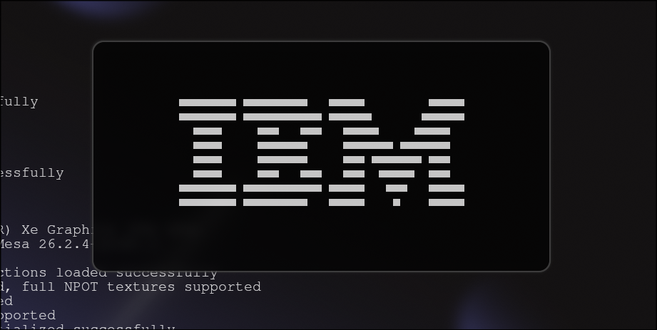
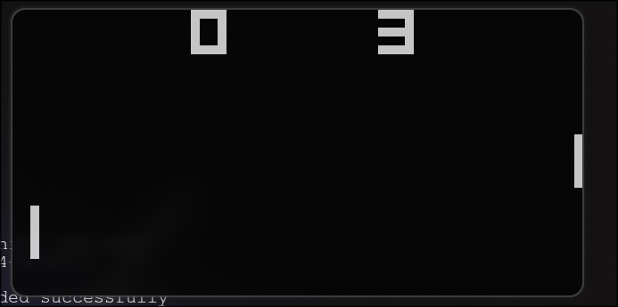
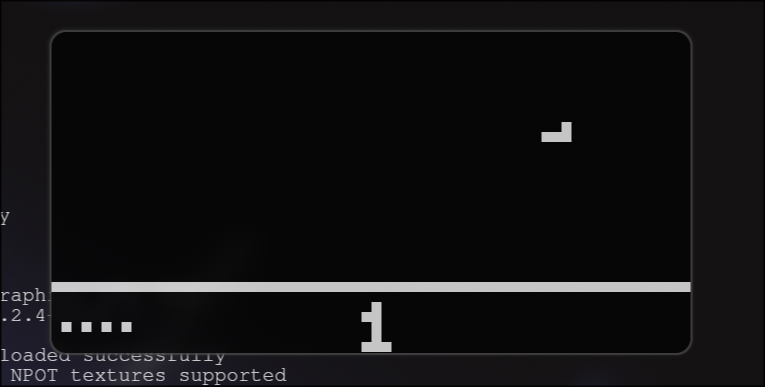

# CHIP-8 emulator

A CHIP-8 emulator written in C++ using raylib.

## Requirements

- A C++23 compiler with support for the `std` module
- A compatible prebuilt `std.pcm` module
- raylib
- `make` and `pkg-config`

The standard module file is not included in this repository. Set up C++23
standard-library module support for your compiler and place the resulting
`std.pcm` in the project directory. The module must be compatible with the
compiler and standard library used to build the program.

## Build

```sh
make
```

This builds the executable as `./chip8`.

## Run

Pass a CHIP-8 ROM file as the first argument:

```sh
./chip8 "roms/IBM Logo.ch8"
```

Some ROMs are included in the `roms/` directory.

If you wish to add more ROMs, you can find them online or check out [this repository](https://github.com/kripod/chip8-roms/tree/master)

## Preview





## Controls

The CHIP-8 keypad is mapped to the keyboard like this:

```text
1234
qwer
asdf
zxcv
```